# 😈 HEX ROOT SCAN (v1.0.4)     <a href="https://kotlinlang.org" target="_blank">

**😈 HEX ROOT SCAN** Apk
Es una potente herramienta de auditoría de redes y pruebas de penetración diseñada exclusivamente para dispositivos Android. Con una interfaz limpia, oscura y optimizada, permite a desarrolladores y entusiastas de la ciberseguridad realizar análisis avanzados directamente desde la palma de su mano.

---

  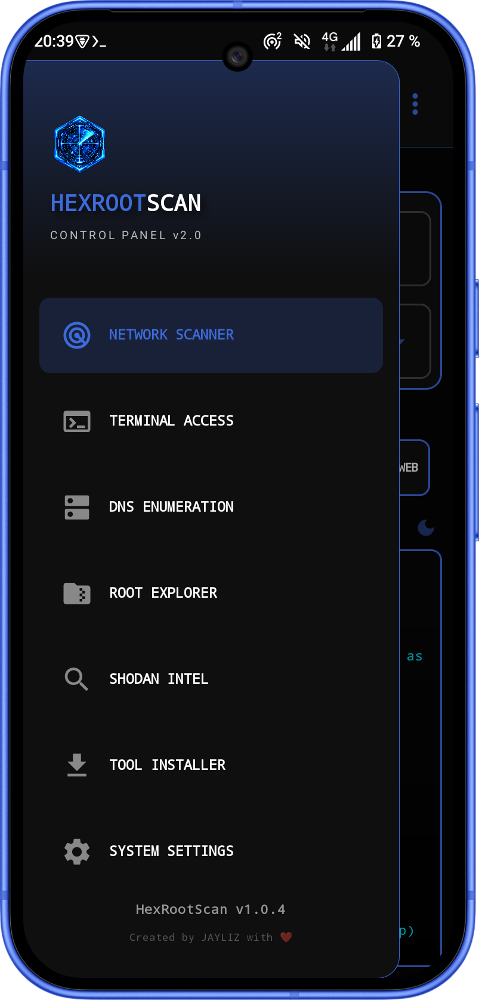
  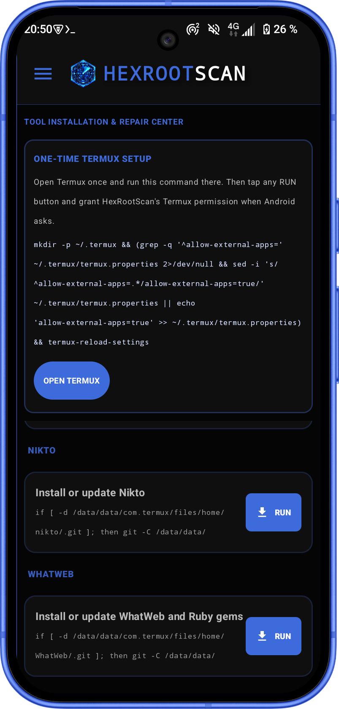

  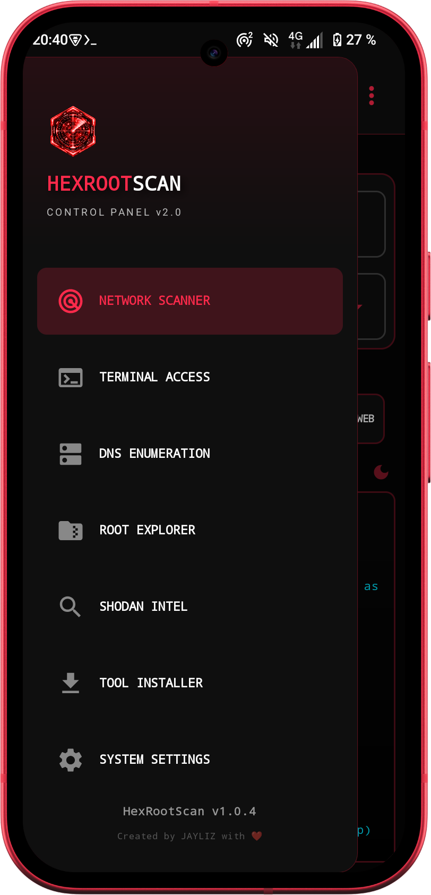
  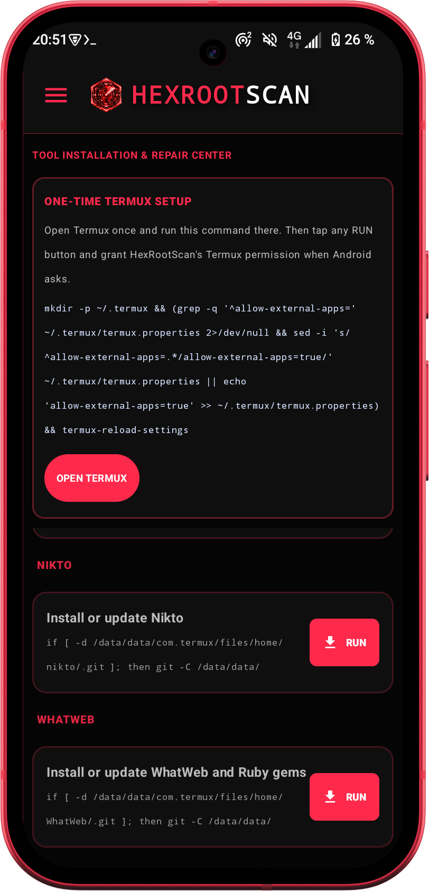

---

## 🚀 Key Features

*   **🕵️‍♂️ Análisis avanzado de red (Nmap integrado):** Realiza escaneos de puertos, detección de servicios y mapeo de red de forma nativa.

  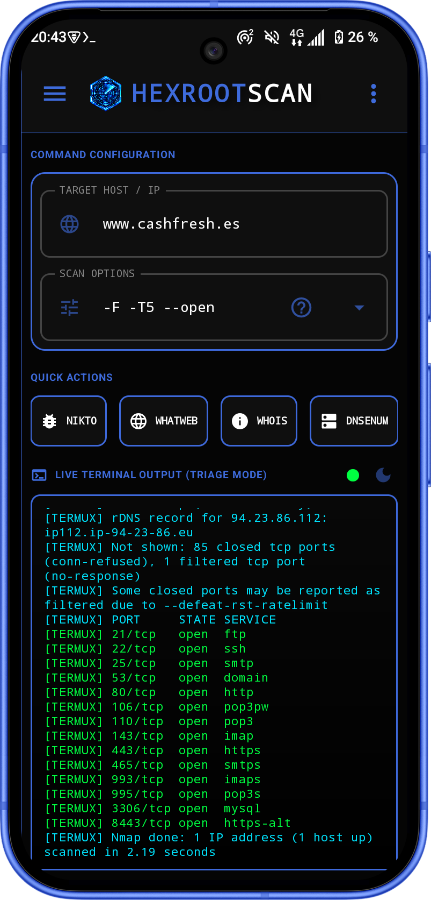
  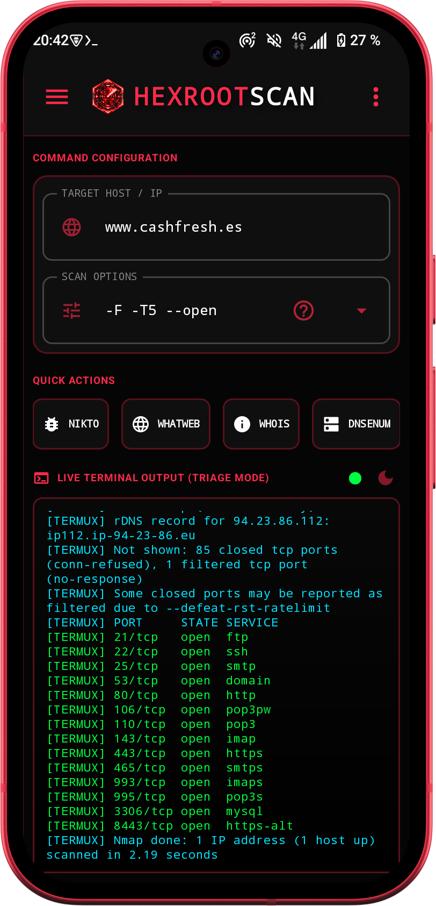

*   **🌐 Reconocimiento de dominios (Whois y Dig):** Consulta la información de registro de dominios y analiza los registros DNS de cualquier host en segundos.

  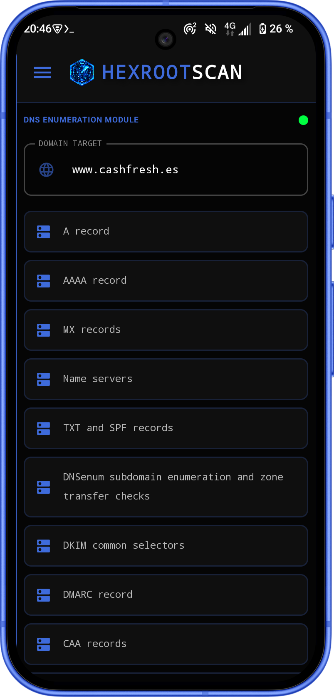
  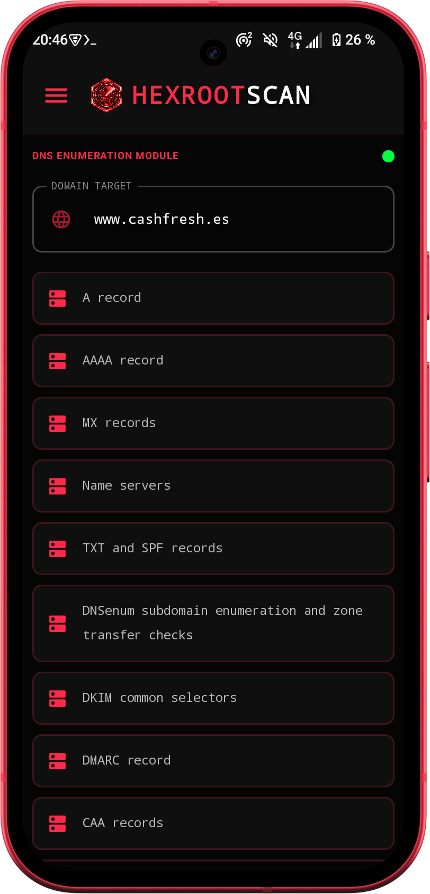

*   **🔥 Escáner de vulnerabilidades (Nikto):** Identifica configuraciones inseguras y archivos peligrosos en los servidores web objetivo.

  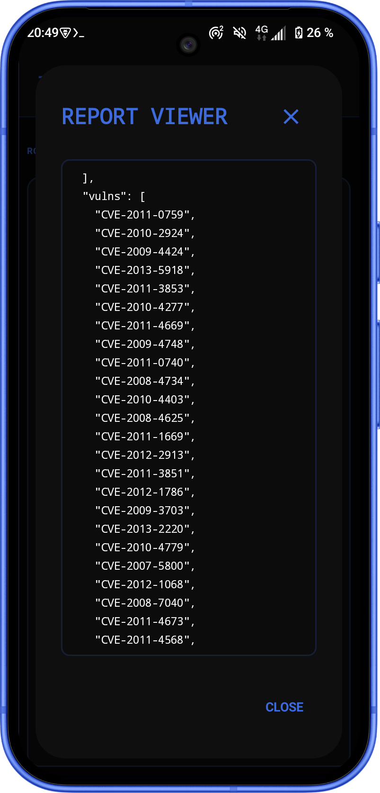
  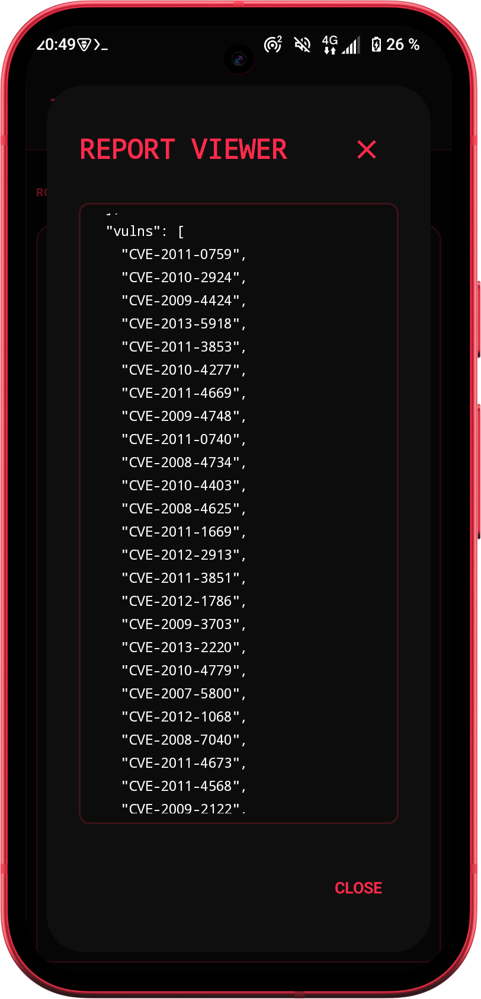

*   **🛡️ Integración con Shodan:** Busque directamente en la base de datos de Shodan para identificar los dispositivos conectados y los puertos expuestos utilizando su clave API.

  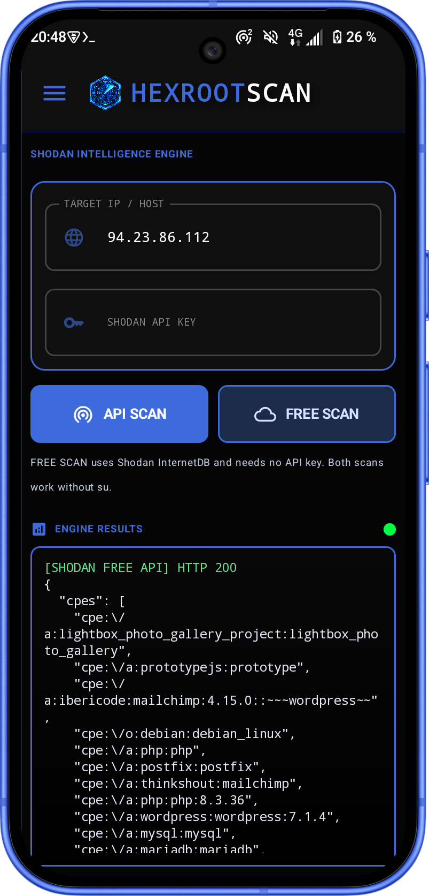
  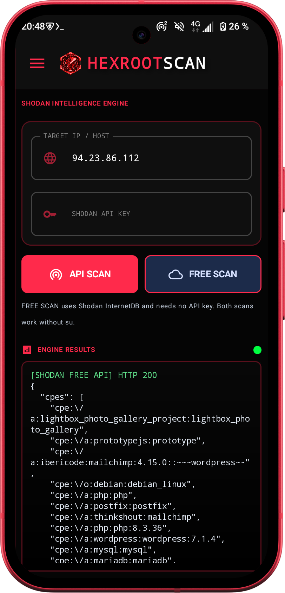

*   **⚡ Listo para acceso root:** Diseñado para funcionar de forma nativa con privilegios de superusuario (`su`) para maximizar el rendimiento de las herramientas de red.

  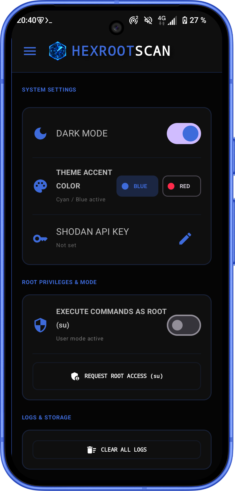
  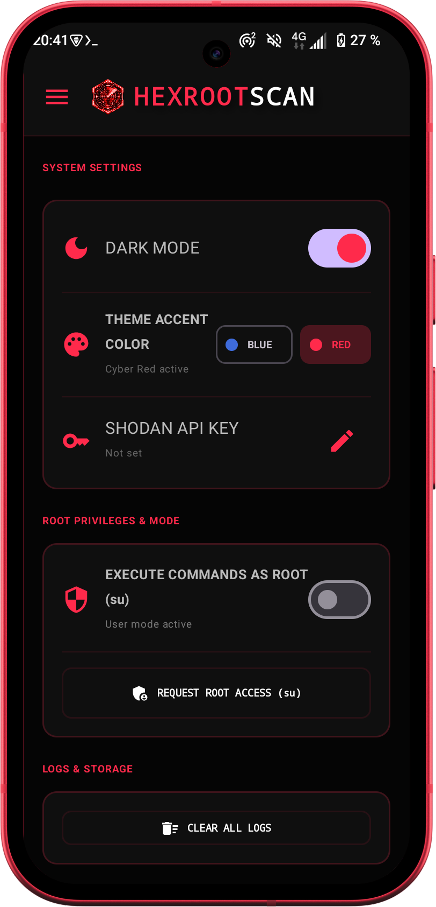

---

## 🛠️ Arquitectura y Tecnologías

*   **Platform:** Native Android (Jetpack Compose for a fluid, modern interface).

*   **Language:** 100% Kotlin.

*   **Security and Optimization:** Advanced code obfuscation using **R8 / ProGuard** to ensure the executable's integrity and lightweight footprint.

---

## ⚠️ Requisitos

*   **Dispositivo rooteado (recomendado):** Necesario para el correcto funcionamiento de herramientas avanzadas como Nmap que necesitan acceso `su`. 

*   **Android 8.0 (API 26) o superior.**

---

## ⚠️ AVISO LEGAL

Esta herramienta está diseñada EXCLUSIVAMENTE para: 

* Pruebas de seguridad autorizadas 
* Auditoría de sus propias redes 
* Investigación educativa

El uso no autorizado en sistemas sin consentimiento es ILEGAL. El autor no asume ninguna responsabilidad por el mal uso.

## 📄 License & Copyright

Copyright © 2026. Todos los derechos reservados. El código fuente de esta aplicación es propiedad privada del desarrollador. Queda prohibida la reproducción, distribución o modificación no autorizada de este software.

*Desarrollado con 💙 por un desarrollador independiente.*
